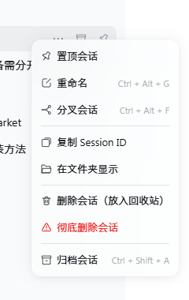
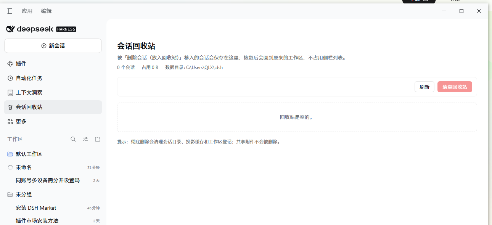

# dsh-session-trash-bin

> 插件显示名：**会话回收站**。npm 包名为 `dsh-session-trash-bin`（`dsh-session-trash`
> 已被 npm 上的另一个包占用）。

> 给 DeepSeek Harness Web UI 的每个会话条目加上右键菜单：
> **「删除会话（放入回收站）」** 和 **「彻底删除会话」**，并提供一个可以恢复的
> **「会话回收站」** 页面。

DSH 原生只提供「归档会话」：归档只是隐藏，会话记录仍然留在磁盘上，而且没有
真正的删除入口。这个插件补上两条删除路径：

| 菜单项 | 行为 |
| --- | --- |
| **删除会话（放入回收站）** | 把会话目录、投影缓存移入 `~/.dsh/storages/session-trash/`，并从工作区登记中摘除。可在「会话回收站」里恢复，恢复到原来的工作区。 |
| **彻底删除会话** | 直接从磁盘删除会话目录、投影缓存和工作区登记，**不进入回收站**，不可恢复。 |

右侧是内置的「归档会话」，与本插件无关，保持原样。





## 效果

在侧栏「工作区」下面任意一个会话条目上点右键，菜单里会多出：

- 删除会话（放入回收站）——垃圾桶图标
- 彻底删除会话——红色危险样式，点击后弹出确认对话框

侧栏导航里会多出「会话回收站」一项（在「上下文洞察」和「更多」之间）。回收站页面
列出每个被删除会话的标题、原工作区、删除时间、占用空间，并提供「恢复」「彻底删除」
和「清空回收站」。

## 安装

本插件是标准 DSH bundle 包（`package.json` 里的 `dsh.bundle.patch`）。

### 1. 从本地目录安装（开发时最方便）

把本目录放到任意位置，然后在 DSH 里让 agent 执行：

```
plugin_manager install_bundle C:/path/to/dsh-session-trash-bin
```

或者在 **插件 → 安装** 里选择本地目录。

### 2. 从 GitHub / npm 安装

插件源码位于 `QLX-Hub/dsh-config` 仓库的 `plugins/dsh-session-trash` 子目录：

```
plugin_manager install_bundle github:QLX-Hub/dsh-config#path:/plugins/dsh-session-trash
```

发布到 npm 后也可以：

```
plugin_manager install_bundle dsh-session-trash-bin
```

### 3. 生效方式

- 已启用 HMR 的 profile（DSH 默认）：安装后 **即时生效**，无需重启；浏览器会通过
  客户端模块图自动加载 Client 半部分。若侧栏没有出现「会话回收站」，刷新页面
  （Ctrl+F5）一次即可。
- 没有 HMR 的 profile：Host 半部分要重启 DSH 后才会挂载路由。
- 之后只改 `lib/client.js`：刷新页面即可；改 `lib/index.js` / `lib/store.js`：
  重启 DSH，或在插件管理器里把本插件「禁用 → 启用」重新挂载。

## 开发

```bash
node --check lib/index.js && node --check lib/store.js && node --check lib/client.js
node test/store.test.mjs
node test/http.test.mjs
node test/client.smoke.test.mjs
```

测试全部在 `mkdtemp()` 出来的假 DSH home 上跑，不会碰真实会话数据。

## 实现思路（怎么给 DSH 做这样的插件）

插件分成 Host 半和 Client 半：

```
lib/index.js    Host：注册 /api/session-trash/* 路由，移动/删除文件、摘除工作区登记
lib/store.js    纯函数：扫描会话产物、回收站目录布局、路径安全、workspace.json 读写
lib/client.js   Client：右键菜单动作、确认对话框、会话回收站面板
cordis.patch.yml 把 Host 插件行插入 profile
package.json    dsh.bundle.patch + dsh.client（Module Loader 包声明）
```

### 1. 右键菜单：`contextMenus` 服务，不需要写 React 组件

DSH 的 `@deepseek-ai/dsh-client-ui-context-menu` 会为每个 Slot 提供
`useContextMenu()`，会话行已经用 `{ kind: 'session', value: { sessionId, displayTitle } }`
注册了右键目标。外部插件只要往同一个 target 注册额外的 action：

```js
ctx.effect(() => ctx.contextMenus.register({
  id: 'session-trash.actions',
  target: 'session',
  order: 700,                       // 排在自带 Pin/Rename/Fork/Archive 之后
  resolve: ({ sessionId, displayTitle }) => [
    {
      id: 'trash',
      label: '删除会话（放入回收站）',
      icon: { key: 'session-trash.trash' },
      separatorBefore: true,
      run: () => moveToTrash(sessionId, displayTitle),
    },
    {
      id: 'purge',
      label: '彻底删除会话',
      icon: { key: 'session-trash.purge' },
      danger: true,
      run: () => purgeSession(sessionId, displayTitle),
    },
  ],
}))
```

图标用 `contextMenu.icon` keyed Slot 注册，动作里的 `icon.key` 对应它：

```js
ctx.slots.inject('contextMenu.icon', function* () {
  yield ctx.slots.register({ name: 'contextMenu.icon', key: 'session-trash.trash' }, TrashGlyph)
  yield ctx.slots.register({ name: 'contextMenu.icon', key: 'session-trash.purge' }, PurgeGlyph)
})
```

插件声明里需要让 Client 半依赖 context-menu 包：

```json
"dsh": {
  "bundle": { "patch": "./cordis.patch.yml" },
  "client": {
    "inject": [
      "@deepseek-ai/dsh-client-ui-slots",
      "@deepseek-ai/dsh-client-ui-context-menu"
    ],
    "platform": "web"
  }
}
```

`lib/client.js` 的入口是 Module Loader 的 CJS 工厂：

```js
window.__ModuleLoader__.load({
  id: 'dsh-session-trash-bin',
  factory(require) {
    const React = require('react')
    // ...
    return { name: 'session-trash', inject: ['slots', 'contextMenus', 'layout'], apply }
  },
})
```

### 2. 会话回收站页面：`main` + `sidebar.panellist` 两个 Slot

DSH 的全局页面是 root 作用域的 `main` keyed Slot，`id` 与 `sidebar.panellist`
里的导航项一致即可互通：

```js
ctx.slots.inject('main', () => ctx.slots.register({
  name: 'main',
  key: 'session-trash',
  inject: () => ({ notify }),        // 作为 props 传给页面组件
}, TrashPanel))

ctx.slots.inject('sidebar.panellist', () => ctx.slots.register({
  name: 'sidebar.panellist',
  id: 'session-trash',
  order: 60,
  label: () => '会话回收站',
}, PanelIcon))
```

### 3. Host 半：`webServer` 前缀路由 + 文件操作

Host 插件是普通的 cordis 插件，注入 `webServer` 后注册前缀路由：

```js
export const name = 'session-trash'
export const inject = ['webServer']

export function apply(ctx, config = {}) {
  ctx.effect(() => ctx.webServer.register({
    kind: 'prefix',
    path: '/api/session-trash',
    handler: (req, res) => route(ctx, options, req, res),
  }))
}
```

路由只接受回环地址 + 同源请求；所有文件路径都经过 `assertInside(home, path)`
校验，保证不会越过 `~/.dsh`。

一个会话在磁盘上由两部分组成：

```
~/.dsh/sessions/<projectKey>/<sessionId>/session.v4.jsonl.zstd
~/.dsh/storages/session_projcache/sessions/<sessionId>.json (+ .bak.*)
```

「放入回收站」= 把这两部分 **rename** 到
`~/.dsh/storages/session-trash/entries/<entryId>/files/<原相对路径>`，并写一份
`meta.json`；恢复时再原路 rename 回去。彻底删除 = 直接 `rm -rf`。

同时还要：

1. 用 `ctx.get('workspaceRegistry')` 的 `workspace.detachSession(id)` 从工作区
   登记里摘除，并清掉 archived/pinned 引用；
2. `ctx.emit('api-session/removed', id)` 通知浏览器立刻移除该行；
3. 对仍在运行的会话先走 `archiveSession(id, { stopActivity: true })` + 取消，
   并要求前端二次确认（`force: true`）。

子 agent 会话没有工作区登记、也不在侧栏显示。插件在 Host 端通过
`sessionQuery.listSessions()` 读 `header.origin === 'subagent'` 的父子关系，把
被删除主会话下所有子 agent 会话一起移入回收站/删除；fork 是独立会话，不连带。

## 删除与保留边界

**会删除**：会话日志目录、投影缓存（含 `.bak.*`）、工作区登记中的会话 id、
archived/pinned 引用。回收站条目保留同样的文件，恢复后原样放回。

**不会删除**：`~/.dsh` 下其他文件、其他会话、按内容寻址的共享附件
（`attachments/` 等，可能被多个会话引用）、会话关联的工作区目录。

**归档 ≠ 删除**：归档的会话仍占磁盘，仍能在「全部对话（显示已归档）」中看到。
本插件不改变归档行为。

## HTTP 接口

所有接口都注册在 DSH Web 服务器的 `/api/session-trash` 前缀下，只允许本机同源调用。

| 方法 | 路径 | 说明 |
| --- | --- | --- |
| GET | `/health` | 插件名、版本、构建时间、当前 DSH home |
| GET | `/list` | 回收站条目列表和总占用 |
| POST | `/trash` | `{ sessionIds, titles?, force? }` 移入回收站 |
| POST | `/delete` | `{ sessionIds, titles?, force? }` 彻底删除 |
| POST | `/restore` | `{ entryIds }` 从回收站恢复 |
| POST | `/purge` | `{ entryIds }` 从回收站永久删除 |
| POST | `/empty` | 清空回收站 |

返回体固定是 `{ ok, ... }`；`ok: false` 时 `failures` 里给出逐条原因，
`failures[].needsForce === true` 表示会话正在运行，前端确认后再带 `force: true` 重试。

## 配置

一般不需要配置。可选 `Config.dshHome` 把插件指向另一个 DSH home（沙箱测试用）：

```yaml
- id: session-trash
  name: 'dsh-session-trash-bin'
  config:
    dshHome: D:/tmp/dsh-sandbox
```

## 已知限制

- **恢复后需要刷新页面**：恢复会写回会话文件，但 Host 的内存会话目录不一定
  立刻重新列出它；插件在恢复成功后会提示并自动刷新页面。
- **运行中的会话**：需要二次确认；插件会先请求停止，但界面上的行可能需要刷新
  才会完全消失。
- **回收站不会自动过期**：条目一直保留，直到手动「彻底删除」或「清空回收站」。
- **不清理附件**：共享附件按内容寻址，可能被其他会话引用，故意保留。
- **只处理会话行**：工作区（分组）本身的删除仍走 DSH 自带功能，本插件不改动。

## License

MIT
